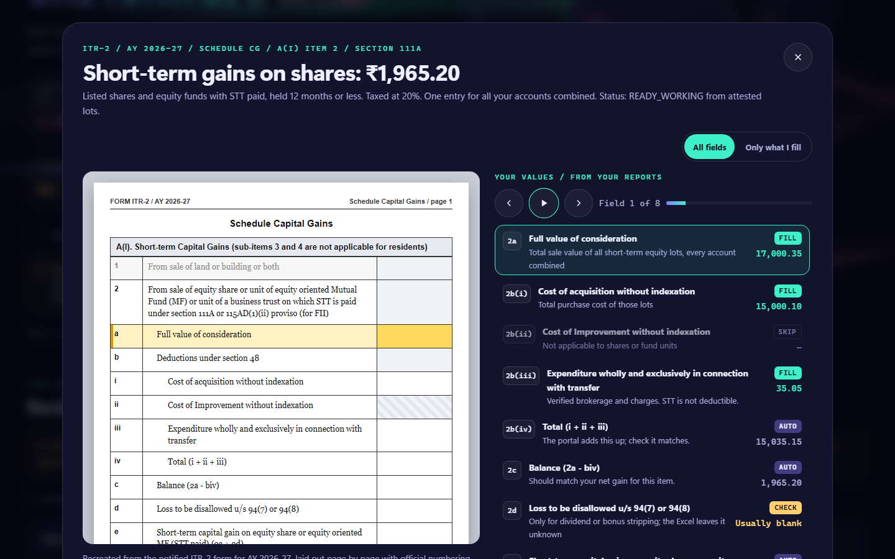
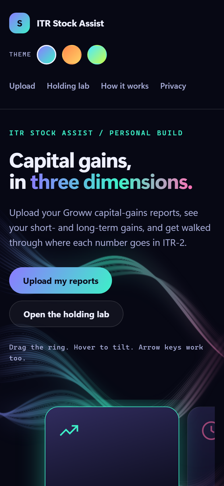

<div align="center">

# ITR Stock Assist

**Upload your Groww capital-gains reports. See your STCG and LTCG. Get walked through where each number goes in ITR-2.**

Runs entirely in your browser. Your files never leave your machine.

[**Open the live site**](https://ddarksaber.github.io/ITR-Stock-Assist/)


</div>

## What it does

- Reads **Groww Stock** and **Mutual Fund** capital-gains reports (XLSX), or a canonical CSV
- Splits gains into **STCG (111A)**, **LTCG (112A)** and **other STCG (slab rate)**
- Shows the numbers as ITR-2 forms (A2, A5, 112A, set-off E, quarters F), field by field
- Flags intraday trades (likely ITR-3), and lists dividends for Schedule OS
- Exports an Excel working paper with the source row behind every number

<div align="center">

</div>

## Walk through each form

Click a card to see the official form on the left and **your values** on the right, tagged FILL, SKIP, AUTO or CHECK.

<div align="center">

</div>

## Run it

Serve the folder over HTTP. Opening `index.html` directly does not work.

```
python -m http.server 8000
```

Then open <http://localhost:8000>, click **Try synthetic sample**, then **Review capital gains**.

The first review downloads the Python runtime (Pyodide) from a CDN, so you need internet once.

## Private by design

- Parsing, maths and the Excel export all run in your browser (Pyodide + openpyxl)
- No server, no analytics, no storage, no web fonts
- Reset clears everything on the page
- Keep real reports out of this folder (`*.xlsx` is git-ignored)

## Good to know

This is a **working paper, not a filing-ready return**. Broker figures stay provisional until you confirm costs, fees and STT. It does not compute tax, set-off or surcharge. Check against your broker reports and get tax advice before filing.

Supports FY 2024-25 and FY 2025-26.

## Develop

```
python -m venv .venv
.venv\Scripts\python -m pip install -e ".[dev]"
.venv\Scripts\python -m pytest -q -m "not browser"
.venv\Scripts\python -m playwright install chromium
.venv\Scripts\python -m pytest -q -m browser
```

Plain HTML, CSS and JS in `web/`, with a Python engine in `stock_assist/`. No build step.

## More

- [Full reference](docs/reference.md): import formats, canonical CSV contract, tax-rule boundaries, workbook sheets
- [Workbook contract](docs/workbook-contract.md)
- [Research and sources](docs/research-2026-10-16.md)

<div align="center">

</div>
